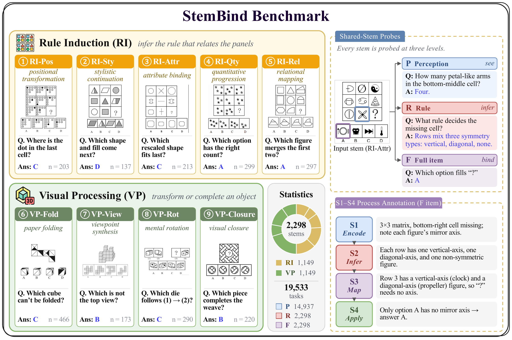
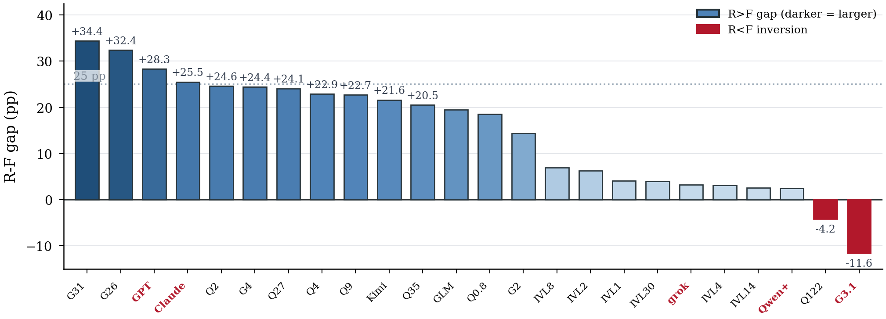

<div align="center">

# StemBind: When MLLMs Get Lost Between Rules and Instances in Abstract Visual Reasoning

**NeurIPS 2026 · Evaluations & Datasets Track**

Xixiang He<sup>1</sup>, Baiqi Wu<sup>2</sup>, Xingming Li<sup>1</sup>, Ao Cheng<sup>1</sup>, Qiyao Sun<sup>1</sup>, Xuanyu Ji<sup>1</sup>, Qingyong Hu<sup>3*</sup>

<sup>1</sup>National University of Defense Technology &nbsp;&nbsp; <sup>2</sup>Zhejiang University &nbsp;&nbsp; <sup>3</sup>Intelligent Game and Decision Lab
<br><sup>*</sup>Corresponding author

<a href="https://arxiv.org/abs/2606.00148"></a>
<a href="https://hexixiang.github.io/StemBind/"></a>
<a href="https://huggingface.co/datasets/user48271/Stembind"></a>
<a href="LICENSE"></a>

</div>

<p align="center">
  
</p>

**StemBind** is a diagnostic benchmark for abstract visual reasoning (AVR) in multimodal LLMs. Each visual stem is probed three ways on the same image: **P**erception (what is in it), **R**ule (what pattern governs it), and **F**ull item (which option completes it). Every F item is also annotated with four reasoning stages, **S1 Encode → S2 Infer → S3 Map → S4 Apply**, so a wrong final answer can be traced to the step that failed.

- **2,298** knowledge-light stems over **9** visual operations (5 Rule-Induction, 4 Visual-Processing)
- **19,533** tasks: 14,937 P · 2,298 R · 2,298 F
- **24** frontier MLLM configurations evaluated

## News

- **2026-10** Evaluation code released.
- **2026-09** StemBind is accepted to the NeurIPS 2026 Evaluations & Datasets Track.
- **2026-05** Paper released on [arXiv](https://arxiv.org/abs/2606.00148).

## Leaderboard

Overall accuracy (%) on the full benchmark, sorted by F. Per-operation scores and thinking-mode deltas are in Table 2 of the paper.

| # | Model | Type | P | R | F | R − F |
|:-:|:--|:--|--:|--:|--:|--:|
| 1 | Qwen3.5-Plus | Proprietary | 71.9 | 44.7 | **42.2** | +2.5 |
| 2 | Qwen3.5-27B | Open | 72.9 | 65.4 | **41.3** | +24.1 |
| 3 | Qwen3.5-35B-A3B | Open | 72.6 | 59.8 | **39.3** | +20.5 |
| 4 | Qwen3.5-9B | Open | 68.9 | 60.1 | **37.4** | +22.7 |
| 5 | Kimi-K2.5 | Open | 65.9 | 58.4 | **36.8** | +21.6 |
| 6 | Qwen3.5-2B | Open | 61.4 | 60.5 | **35.9** | +24.6 |
| 7 | Gemini-3.1-Pro | Proprietary | 58.7 | 24.3 | **35.9** | -11.6 |
| 8 | GLM-4.5V | Open | 63.4 | 54.1 | **34.6** | +19.5 |
| 9 | Qwen3.5-4B | Open | 66.5 | 56.7 | **33.8** | +22.9 |
| 10 | Qwen3.5-122B-A10B | Open | 55.7 | 29.6 | **33.8** | -4.2 |
| 11 | Gemma-4-31B-it | Open | 67.0 | 67.5 | **33.1** | +34.4 |
| 12 | Gemma-4-26B-A4B-it | Open | 71.7 | 65.4 | **33.0** | +32.4 |
| 13 | GPT-5.4 | Proprietary | 61.2 | 60.1 | **31.8** | +28.3 |
| 14 | Claude-Opus-4.7 | Proprietary | 60.8 | 56.2 | **30.7** | +25.5 |
| 15 | Gemma-4-E4B-it | Open | 66.0 | 55.0 | **30.6** | +24.4 |
| 16 | Qwen3.5-0.8B | Open | 41.5 | 48.7 | **30.2** | +18.5 |
| 17 | InternVL3.5-30B-A3B | Open | 45.1 | 32.9 | **28.9** | +4.0 |
| 18 | Gemma-4-E2B-it | Open | 58.9 | 43.0 | **28.6** | +14.4 |
| 19 | Grok-4.2-beta | Proprietary | 49.3 | 31.3 | **28.1** | +3.2 |
| 20 | InternVL3.5-14B | Open | 43.2 | 30.7 | **28.1** | +2.6 |
| 21 | InternVL3.5-8B | Open | 39.5 | 33.6 | **26.7** | +6.9 |
| 22 | InternVL3.5-4B | Open | 36.8 | 27.9 | **24.8** | +3.1 |
| 23 | InternVL3.5-2B | Open | 34.9 | 29.4 | **23.1** | +6.3 |
| 24 | InternVL3.5-1B | Open | 30.6 | 24.8 | **20.7** | +4.1 |

Rule accuracy exceeds full-item accuracy for 22 of 24 models: most models can state the rule but fail to bind it to the right option.

## Key Findings

1. **R–F chasm.** Most failures happen *after* the rule is identified.
2. **Binding gap.** Even when P and R are both correct on a stem, models miss F **51.2%** of the time.
3. **S3 bottleneck.** Stage judging and Stage-wise Stimulus Augmentation (SSA) localize the failure to rule-to-instance mapping.
4. **Scale and thinking do not close it.** Larger models and explicit thinking leave the gap open; thinking lowers R and F on every paired row.

<p align="center">
  
</p>

## Getting Started

### Install

```bash
git clone https://github.com/hexixiang/StemBind.git
cd StemBind
pip install -r requirements.txt
bash scripts/smoke_test.sh        # offline check on a synthetic fixture
```

### Prepare the data

```bash
python scripts/prepare_data.py --out-dir data/stembind
```

This downloads the [Hugging Face release](https://huggingface.co/datasets/user48271/Stembind) and writes the layout the harness reads ([schema](evaluation/README.md)). Pass `--hf-dir` to reuse a local copy.

### Evaluate a model

Any OpenAI-compatible endpoint works (OpenAI, vLLM, SGLang, etc.):

```bash
export OPENAI_API_BASE=https://your-endpoint/v1
export OPENAI_API_KEY=...

# 1. P/R/F predictions
python evaluation/cli.py --live run --dataset-dir data/stembind \
  --models your-model --conditions full-image --out-dir outputs/your-model

# 2. Answer grading for free-form P/R answers
python evaluation/cli.py --live answer-judge --dataset-dir data/stembind \
  --predictions outputs/your-model/predictions.jsonl --judge-model gpt-4o

# 3. Optional: S1-S4 trace judging (GPT-4o, temperature 0, as in the paper)
python evaluation/cli.py --live judge --dataset-dir data/stembind \
  --predictions outputs/your-model/predictions_answer_judged.jsonl

# 4. Metrics
python evaluation/cli.py metrics \
  --predictions outputs/your-model/predictions_judged.jsonl --out-dir outputs/your-model/metrics
```

Skip step 3 to get P/R/F accuracy only; then point step 4 at `predictions_answer_judged.jsonl`. Commands run in `--dry-run` mode by default (stub model, no API calls); `--live` sends real requests. The `ssa` and `thinkgain` subcommands reproduce the SSA and thinking-mode analyses. Run `python evaluation/cli.py <command> -h` for all options.

## Repository Structure

```text
StemBind/
├── evaluation/             # CLI, harness, judges, metrics, SSA, ThinkGain
├── data_processing/common/ # OpenAI-compatible HTTP helper
├── data/                   # answer key and operation labels per image
├── scripts/                # data preparation and smoke test
└── docs/                   # project page (GitHub Pages)
```

## Citation

If you find StemBind useful, please cite:

```bibtex
@inproceedings{he2026stembind,
  title     = {StemBind: When MLLMs Get Lost Between Rules and Instances in Abstract Visual Reasoning},
  author    = {He, Xixiang and Wu, Baiqi and Li, Xingming and Cheng, Ao and Sun, Qiyao and Ji, Xuanyu and Hu, Qingyong},
  booktitle = {Advances in Neural Information Processing Systems (NeurIPS)},
  year      = {2026}
}
```

## License

Code is released under the [Apache License 2.0](LICENSE). The dataset and `data/stembind_labels.jsonl` are released under [CC BY 4.0](https://creativecommons.org/licenses/by/4.0/).
